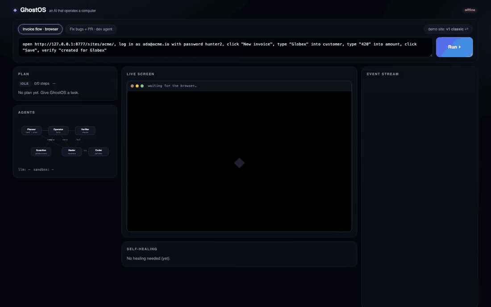
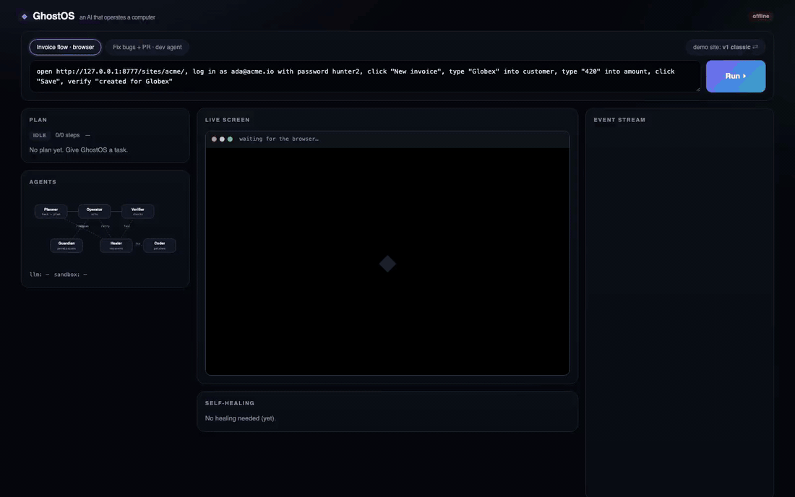
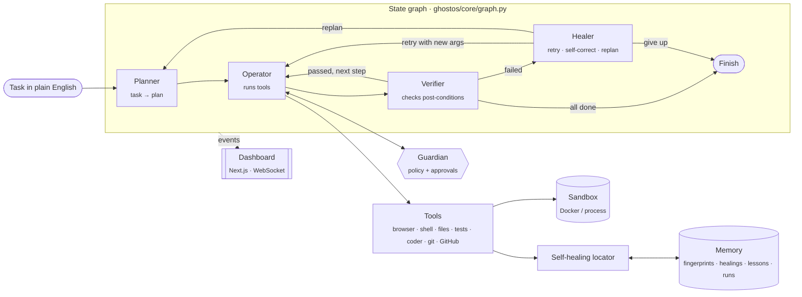
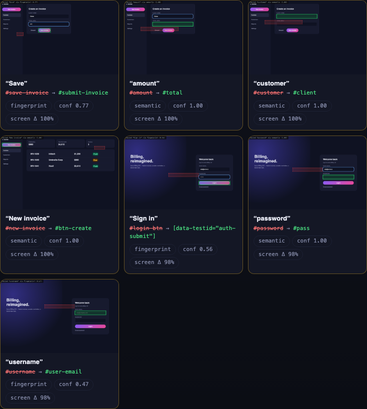
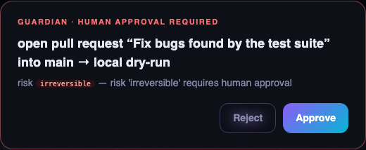

<p align="center">
  
</p>

<p align="center">
  <a href="https://github.com/amartya1523/GhostOS-An-AI-That-Can-Operate-a-Computer/actions/workflows/ci.yml"></a>
  
  
  
  
  
  
</p>

<p align="center">
  <b>GhostOS doesn't just answer questions — it operates a computer.</b><br>
  You give it a task in plain English. It plans, clicks, types, runs code, checks its own work,<br>
  and when something breaks — a button moved, a patch was wrong — it notices, recovers, and <i>remembers</i>.
</p>

---

## ▶ See it work (real runs, not mock-ups)

### 1 · Self-healing: the website gets redesigned mid-flight

GhostOS learns a billing app, then the app ships a redesign: new layout, new IDs, renamed buttons.
A classic Playwright script dies on step one (`page.fill('#username')` → `TimeoutError`).
GhostOS re-finds **7 of 9** elements on its own, explains every decision, and the next run needs **zero** healing.

<p align="center">
  
</p>

<p align="center">
  🎬 <a href="docs/media/healing.mp4">Full-quality MP4 (1:11)</a> ·
  📝 subtitles: <a href="docs/media/healing.srt">.srt</a> / <a href="docs/media/healing.vtt">.vtt</a> (also embedded as a soft track in the MP4)
</p>

### 2 · Dev agent: find bugs → patch → self-correct → test → pull request

GhostOS copies a repo into a sandbox, runs the tests (3 failing), patches the source, **catches that its
own first patch was incomplete**, feeds the failure back to itself, fixes the real root cause, goes green
(12/12), commits on a branch, and then **stops to ask a human** before opening a pull request.

<p align="center">
  
</p>

<p align="center">
  🎬 <a href="docs/media/dev-agent.mp4">Full-quality MP4 (0:50)</a> ·
  📝 subtitles: <a href="docs/media/dev-agent.srt">.srt</a> / <a href="docs/media/dev-agent.vtt">.vtt</a>
</p>

> **Honesty note.** The dev-agent recording uses GhostOS's *scripted* LLM provider so the demo is reproducible
> in CI without an API key (the replies live in [`fixtures/buggy_repo/.ghost/script.json`](fixtures/buggy_repo/.ghost/script.json),
> and the first patch is deliberately incomplete to exercise self-correction). Everything else — the sandbox,
> test runs, patch application, verification loop, git branch, approval gate — is real. Set `ANTHROPIC_API_KEY`
> and GhostOS uses Claude for genuine reasoning. The self-healing demo uses **no LLM at all**.

Both videos are produced by [`scripts/record_demos.py`](scripts/record_demos.py), which boots a fresh server with
empty memory and drives the dashboard in a real browser. Re-run it and you get the same film.

---

## Why this is hard (and what's different)

| | Classic automation (Selenium / Playwright scripts) | "Chat with an LLM" | **GhostOS** |
|---|---|---|---|
| Input | Hand-written selectors | Natural language | Natural language → typed, auditable plan |
| UI redesign | 💥 breaks | Re-reads the screen every step (slow, costly, non-deterministic) | Heals once via multi-signal fingerprints, **remembers** the fix |
| "Did it work?" | Whatever the script asserts | Usually trusts itself | Separate **Verifier** agent checks real post-conditions |
| Wrong attempt | Fails | Often repeats the mistake | **Healer** feeds the evidence back → self-correction |
| Dangerous actions | Anything goes | Anything goes | Risk-scored, policy-gated, **human approval** for irreversible steps |
| Running code | On your machine | — | Docker sandbox (no network, read-only root, dropped caps) |
| Explainability | Stack trace | Chat log | Live dashboard, event trace, annotated screenshots, healing records |

---

## Architecture



| Layer | What it does | Where |
|---|---|---|
| **State graph** | ~100-line LangGraph-style engine: nodes, routers, loop guard, observable transitions | [`core/graph.py`](ghostos/core/graph.py) |
| **Planner** | Deterministic grammar for common commands (offline, auditable); LLM + tool JSON-schemas + recalled lessons for everything else | [`agents/planner.py`](ghostos/agents/planner.py) |
| **Operator** | Runs each step through the permission gate, then the tool; a crashing tool can never kill the run | [`agents/orchestrator.py`](ghostos/agents/orchestrator.py) |
| **Verifier** | "Returned without an exception" ≠ success. Checks page text, URL, exit codes, re-runs the test suite | [`agents/verifier.py`](ghostos/agents/verifier.py) |
| **Healer** | Classifies failures: back-off retry, wait-longer, feed-evidence-to-coder, replan, or stop and explain | [`agents/healer.py`](ghostos/agents/healer.py) |
| **Self-healing locator** | 5-rung strategy ladder + element fingerprints + screenshot diff + annotated evidence | [`perception/`](ghostos/perception) |
| **Memory** | SQLite: procedural (fingerprints), episodic (runs, events, healings), semantic (lessons + vector recall) | [`memory/`](ghostos/memory) |
| **Guardian** | Risk levels, YAML policy, host allow-list, shell-command classifier, async human approvals | [`safety/`](ghostos/safety) |
| **Sandbox** | Docker (`--network none --read-only --cap-drop ALL …`) with an rlimit'd process fallback | [`sandbox/`](ghostos/sandbox) |
| **Dashboard** | Live plan, agent graph, browser frames, healing feed, patch diffs, approval modal | [`dashboard/`](dashboard) |

Deeper dive: [docs/ARCHITECTURE.md](docs/ARCHITECTURE.md) · design research: [docs/RESEARCH.md](docs/RESEARCH.md)

---

## How self-healing actually works

A CSS selector stores **one** fact about an element. Redesigns change that fact, and the script dies.
GhostOS stores a **fingerprint** — many weak facts — the first time it touches an element:

| Signal | Weight | Survives a redesign when… |
|---|---:|---|
| Names (visible text, `aria-label`, `<label>`, placeholder, `name`) | 0.22 | the wording is similar ("Save" → "Save invoice") |
| Kind (tag + input type) | 0.16 | it's still a button / a text field |
| Position (normalised centre) | 0.16 | it stayed roughly in place |
| Context (preceding label, section heading, container) | 0.14 | it's still in the login form |
| Order among its form's controls | 0.10 | it's still the 3rd control in the form |
| Class vocabulary (Jaccard) | 0.10 | the design system kept `btn-primary` |
| Identity (`id`, `name`, `role`, `autocomplete`) | 0.12 | any stable attribute survived |

When the remembered selector dies, the locator climbs a ladder, cheapest and most certain first:

```
1 memory       remembered selector still points at a similar element        → no healing
2 semantic     an element is named (almost) exactly like the target          → heal
3 fingerprint  best fingerprint match passes a ratio test vs. the runner-up  → heal
4 fuzzy-text   an element is named somewhat like the target                  → heal
5 vision       a multimodal LLM picks from a numbered set of candidates     → heal (optional)
```

The **ratio test** (borrowed from feature matching in computer vision) is the key design choice: a match is
accepted when it is strong (≥ 0.55 with a 0.05 lead) **or** clearly better than every alternative
(≥ 0.42 with a 0.12 lead). That's how "Username" → "Work email" heals at 0.47 (the runner-up scores 0.31)
while genuinely ambiguous screens are refused instead of guessed.

Every healing is backed by evidence: before/after screenshot diff (perceptual hash + changed-pixel ratio),
an annotated screenshot (old position in red, new element in green), the per-signal score breakdown,
and a stored record + lesson in memory. Real output from the demo above:

```text
$ ghost memory
runs: 3 · events: 258 · fingerprints: 7 · healings: 7 · lessons: 7
 label        old selector    new selector                  strategy     confidence  ui change
 save         #save-invoice   #submit-invoice               fingerprint  0.77        100%
 amount       #amount         #total                        semantic     1.00        100%
 customer     #customer       #client                       semantic     1.00        100%
 new invoice  #new-invoice    #btn-create                   semantic     1.00        100%
 sign in      #login-btn      [data-testid="auth-submit"]   fingerprint  0.56        98%
 password     #password       #pass                         semantic     1.00        98%
 username     #username       #user-email                   fingerprint  0.47        98%
```

<p align="center"></p>

---

## Safety model

Every tool declares a risk level, and some compute it from their arguments (`git status` is *read*, `git push --force` is *irreversible*):

`read` → `write` → `execute` → `network` → `irreversible`

* **Policy** ([`policy.example.yaml`](policy.example.yaml)): auto-approve up to a level, hard-refuse above another, allow-list hosts, deny tools.
* **Shell guard**: blocks the catastrophic outright (`rm -rf /`, `mkfs`, fork bombs, `curl … | sh`) and escalates risky commands.
* **Human in the loop**: approvals stream to the dashboard (or a CLI prompt) and the run waits. A rejection stops the run cleanly.
* **Local API hardening**: state-changing endpoints require an `x-ghostos-client` header, which a foreign web page can't send without a CORS preflight that fails, and the event WebSocket checks `Origin`. So a random website can't start runs or click "Approve" for you.
* **Secrets**: passwords and tokens in a task are redacted before they reach memory, traces, events or lessons, and typed field values are never fingerprinted.
* **Sandbox**: code runs in a throwaway container with no network, a read-only root, all capabilities dropped, memory/CPU/PID limits and a non-root user. The image is never pulled, only built locally, and timed-out containers are force-removed. Without Docker it falls back to a process sandbox, which is **not** isolation (it can read your files and use the network) but does scrub the environment so API keys don't leak, apply rlimits, and hard-kill on timeout.
* **Workspace isolation**: the dev agent works on a copy. The coder is not allowed to edit tests (no "fixing" a bug by deleting its test), and every path is checked for `../` escapes.

<p align="center"></p>

---

## Quickstart

```bash
git clone https://github.com/amartya1523/GhostOS-An-AI-That-Can-Operate-a-Computer.git ghostos
cd ghostos
python -m venv .venv && source .venv/bin/activate
pip install -e ".[dev]" && python -m playwright install chromium
```

```bash
# Dashboard + API + demo site on http://127.0.0.1:8765
(cd dashboard && npm ci && npm run build)
ghost serve
```

```bash
# Or drive it from the terminal
ghost run 'open http://127.0.0.1:8765/sites/acme/, log in as ada@acme.io with password hunter2, click "New invoice", type "Globex" into customer, type "420" into amount, click "Save", verify "created for Globex"'
```

```bash
# Flip the demo site to its redesign and run the same command again
curl -X POST localhost:8765/sites/acme/deploy -H 'x-ghostos-client: cli' -H 'content-type: application/json' -d '{"version":"v2"}'
```

```bash
# The dev agent (reproducible scripted replies), approving the PR from the CLI prompt
ghost run "fix the failing tests in fixtures/buggy_repo and open a pull request" --provider scripted --script fixtures/buggy_repo/.ghost/script.json
```

```bash
# What has GhostOS learned?
ghost memory
```

**Use a real model** by setting `ANTHROPIC_API_KEY` (Claude), or `OPENAI_API_KEY` / `OPENAI_BASE_URL` for any
OpenAI-compatible endpoint (OpenAI, Ollama, vLLM, LM Studio). `--provider auto` picks whichever is configured.
To open real pull requests, set `GITHUB_TOKEN` and include `github.com/<owner>/<repo>` in the task; without it, the PR is drafted locally as `pull_request.md`.

| Variable | Default | Meaning |
|---|---|---|
| `GHOSTOS_HOME` | `.ghostos` | memory database, run traces, screenshots |
| `GHOSTOS_PROVIDER` | `auto` | `auto` · `offline` · `anthropic` · `openai` · `scripted` |
| `GHOSTOS_SANDBOX` | `auto` | `auto` (Docker if available) · `docker` · `process` |
| `GHOSTOS_POLICY` | — | path to a policy YAML |
| `GHOSTOS_STEP_DELAY_MS` | `0` | slow-motion between steps, for demos |

Docker: `docker build -f docker/sandbox.Dockerfile -t ghostos/sandbox .` builds the sandbox image, and `docker compose up` runs the whole app. Both Dockerfiles are included, but CI does not build them yet. The unit tests check the sandbox's `docker run` flags, and the demos above ran on the process sandbox.

---

## Engineering

* **79 tests** (`pytest -q`): unit tests for every subsystem plus end-to-end tests that drive a real Chromium through the redesign and run the full dev-agent loop, including a rejected approval, plus regression tests for CSRF, secret redaction and injection hardening.
* **Typed**: `mypy` clean. Tools are generic over their pydantic argument models, so every tool gets a JSON schema for LLM tool-use for free.
* **Lint/format**: `ruff`. **CI**: GitHub Actions runs lint, types, tests (with Playwright) and the dashboard build.
* **Observable by construction**: every agent action is an `Event`, fanned out to the WebSocket, a per-run `trace.jsonl`, and SQLite.
* **Small dependency surface**: no agent framework; the graph engine, embedder and fingerprinting together are under 400 lines of readable code.

```
ghostos/
  core/        types, event bus, state-graph engine
  agents/      planner, verifier, healer, orchestrator (the graph)
  perception/  fingerprints, self-healing locator, screenshot diff/annotation
  memory/      SQLite store + hashing embedder / vector recall
  safety/      policy, shell guard, permission gate + approval broker
  sandbox/     Docker + process sandboxes
  tools/       browser, shell/files, workspace/tests/coder/git/GitHub
  llm/         Anthropic, OpenAI-compatible, scripted providers
  server/      FastAPI REST + WebSocket, demo site
dashboard/     Next.js + TypeScript live dashboard (static export)
fixtures/      Acme Billing v1/v2 demo site, buggy repo for the dev agent
scripts/       demo-video recorder (captions + .srt/.vtt)
tests/         unit + end-to-end tests
```

---

## Roadmap

- [x] **Phase 1** — Browser automation + natural-language commands
- [x] **Phase 2** — Planning, tools and the execution engine (state graph, multi-agent loop)
- [x] **Phase 3** — Memory, self-correction and verification (fingerprints, healings, lessons, verifier/healer loop)
- [x] **Phase 4** — Sandbox, permissions and security (Docker/process sandbox, policy, shell guard, approvals)
- [x] **Phase 5** — Multi-agent coordination and a full dashboard
- [ ] Desktop control beyond the browser (PyAutoGUI / accessibility APIs), using the same fingerprint idea on accessibility trees
- [ ] PostgreSQL + pgvector memory backend (the schema is already portable)
- [ ] Learned fingerprint weights from healing outcomes, instead of hand-tuned ones
- [ ] Benchmarks on WebArena-style tasks

**Known limitations** (said plainly): the offline grammar covers common browser and dev commands, and open-ended tasks need an LLM.
Fingerprint weights are hand-tuned on the bundled fixtures. The process sandbox is weaker than Docker. Use Docker for untrusted code.

---

<p align="center">
  Built by <b>Amartya Singh</b> · MIT licensed<br>
  <sub>If this made you think "wait, it fixed itself?", a ⭐ helps.</sub>
</p>
